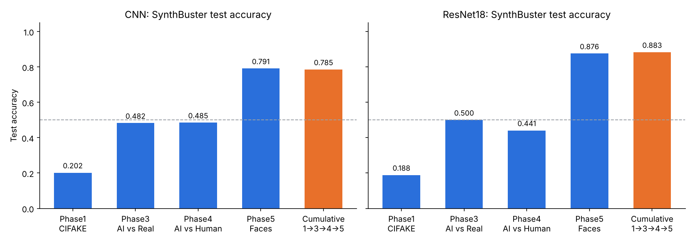
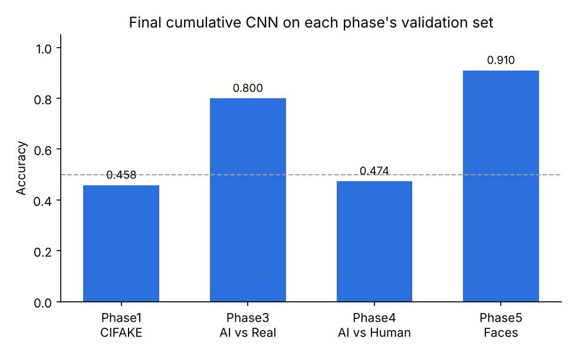

# Stepwise Optimization for AI-Generated Image Detection

> **단계적(누적) 학습으로 AI 생성 이미지 탐지 모델의 일반화 성능을 높일 수 있을까?**

저해상도 CIFAKE에서 시작해 일반 이미지 → 고품질 SDXL 이미지 → 얼굴 이미지 순서로 데이터셋을 바꿔 가며 **이전 가중치를 이어서 학습(누적 학습)** 하고, 학습에 전혀 쓰지 않은 **SynthBuster** 데이터셋으로 일반화 성능을 평가한 프로젝트입니다.

- 과목: 홍익대학교 머신러닝및실습(2) 팀 프로젝트 (2026년 1학기)
- 팀원: 고영훈, 김건우
- 발표 자료: [docs/presentation.pdf](docs/presentation.pdf)


---

## Key Results

| 모델 | 학습 방식 | SynthBuster 정확도 |
| --- | --- | --- |
| CNN | 개별 학습 (Phase1 / 3 / 4 / 5) | 0.202 / 0.482 / 0.485 / **0.791** |
| CNN | **누적 학습 (1 → 3 → 4 → 5)** | **0.785** |
| ResNet18 | 개별 학습 (Phase1 / 3 / 4 / 5) | 0.188 / 0.500 / 0.441 / **0.876** |
| ResNet18 | **누적 학습 (1 → 3 → 4 → 5)** | **0.883** |



- 누적 학습 모델은 Phase1, 3, 4 개별 모델보다 훨씬 높은 정확도를 보였지만, **마지막 단계인 Phase5(얼굴) 개별 모델과는 거의 같았습니다** (CNN 0.785 vs 0.791, ResNet18 0.883 vs 0.876). 일반화 성능의 대부분은 Phase5 데이터에서 온 것으로 보입니다.
- 같은 누적 학습에서 ResNet18(0.883)이 직접 설계한 CNN(0.785)보다 약 **9.8%p** 높았습니다.
- 누적 학습이 끝난 CNN은 앞 단계 데이터를 잊어버렸습니다 (아래 [Catastrophic Forgetting](#catastrophic-forgetting)).

---

## Approach

### 데이터셋과 학습 순서

| 단계 | 데이터셋 (Kaggle) | 해상도 | 규모 | 역할 |
| --- | --- | --- | --- | --- |
| Phase 1 | [CIFAKE](https://www.kaggle.com/datasets/birdy654/cifake-real-and-ai-generated-synthetic-images) | 32×32 | 120,000 | 저해상도 기초 특징 학습 |
| ~~Phase 2~~ | [AI Generated Images vs Real Images](https://www.kaggle.com/datasets/cashbowman/ai-generated-images-vs-real-images) | 다양 | 975 | 성능 저하로 **제외** (val acc 0.387) |
| Phase 3 | [AI vs Real Images](https://www.kaggle.com/datasets/rhythmghai/ai-vs-real-images-dataset) | 512×512 | 995 | 일반 이미지(SDXL), 초기 일반화 |
| Phase 4 | [AI vs Human Generated](https://www.kaggle.com/datasets/alessandrasala79/ai-vs-human-generated-dataset) | 768×512 | 79,950 (train) | 고품질 이미지 |
| Phase 5 | [Real vs AI Generated Faces](https://www.kaggle.com/datasets/philosopher0808/real-vs-ai-generated-faces-dataset) | 512×512 | 120,959 (data_source) | 고난도 얼굴 이미지 |
| **Test** | [SynthBuster](https://www.kaggle.com/datasets/devpatel484/synthbuster-32) (AI 9,000) + [Real Image Dataset](https://www.kaggle.com/datasets/duyminhle/real-image-dataset) (Real 9,000) | – | 18,000 | 학습에 쓰지 않은 데이터로 일반화 평가 |

SynthBuster의 AI 이미지는 DALL·E 2/3, Midjourney v5, Stable Diffusion 1.4/2/XL, GLIDE 등 최신 생성 모델로 만들어졌습니다.

### 전처리

모든 데이터셋을 같은 구조로 바꾼 뒤(`train|val / ai|real`, 8:2 분할, `random.seed(42)`) 128×128로 리사이즈해 학습했습니다. 라벨은 폴더 이름 알파벳 순서로 `ai = 0`, `real = 1`입니다.

### 모델

**CNN** (직접 설계)

```text
Rescaling(1/255) → [Conv2D(32,3) → MaxPool] → [Conv2D(64,3) → MaxPool] → [Conv2D(128,3) → MaxPool]
→ Flatten → Dense(128, ReLU) → Dropout(0.5) → Dense(2, softmax)
```

**ResNet18**: Skip Connection을 가진 18층 잔차 신경망, 입력 224×224

### 실험 설계

```text
① 개별 학습:  Phase1 | Phase3 | Phase4 | Phase5   (각 데이터셋만 처음부터 학습)
② 누적 학습:  Phase1 → Phase3 → Phase4 → Phase5   (이전 단계 가중치를 이어서 학습)
                              ↓
                  SynthBuster로 동일하게 평가
```

누적 학습 CNN의 단계별 설정과 마지막 epoch 성능은 [results/cumulative_training_cnn.csv](results/cumulative_training_cnn.csv)에 있습니다. Phase1은 Adam(1e-3)으로 처음부터, 이후 단계는 학습률 1e-4로 미세 조정했습니다. Phase4를 제외한 단계에서 `EarlyStopping(patience=3)`을 썼습니다.

---

## Catastrophic Forgetting

누적 학습이 끝난 CNN으로 각 단계의 검증 데이터를 다시 평가했습니다.

| Phase1 | Phase3 | Phase4 | Phase5 |
| --- | --- | --- | --- |
| 0.458 | 0.800 | 0.474 | 0.910 |



마지막에 학습한 Phase5는 잘 맞히지만, Phase1과 Phase4는 우연 수준(0.5) 아래로 떨어졌습니다. 새 데이터를 학습하면서 이전 지식을 잃어버리는 **Catastrophic Forgetting** 현상입니다.

---

## Discussion & Limitations

- **누적 학습의 효과는 제한적:** 누적 모델과 Phase5 개별 모델의 차이는 CNN −0.6%p, ResNet18 +0.8%p로 작습니다. 한 번의 실행 결과이므로, 시드를 바꿔 여러 번 반복해야 차이가 의미 있는지 판단할 수 있습니다.
- **0.5보다 낮은 정확도:** CIFAKE 개별 모델(약 0.19~0.20)은 SynthBuster에서 우연(0.5)보다도 훨씬 낮았습니다. 무작위로 틀린 것이 아니라 예측이 체계적으로 반대로 나온 것이어서, 32×32 저해상도에서 배운 특징이 고해상도 이미지에서는 오히려 반대 신호로 작동한 것으로 보입니다.
- **Phase3 클래스 불균형:** 전처리 과정에서 파일 이름만으로 복사해, 카테고리 폴더마다 같은 이름을 가진 AI 이미지가 서로 덮어써졌습니다. 그 결과 AI 이미지가 250장에서 81장(train 50, val 31)으로 줄어 real 745장과 크게 불균형해졌습니다. Phase3의 검증 정확도(약 0.9)는 전부 real로 예측해도 나오는 비율(약 0.83~0.92)과 비슷하므로 해석에 주의해야 합니다.
- **테스트셋 구성:** AI 이미지(SynthBuster)와 Real 이미지가 서로 다른 출처에서 왔기 때문에, 모델이 생성 여부가 아닌 출처의 차이(해상도, 압축 방식 등)를 학습했을 가능성이 있습니다.
- **검증 방식 차이:** 누적 모델은 `train` 폴더 안에서 `validation_split=0.2`로, 개별 모델은 별도의 `val` 폴더로 검증해 두 방식의 검증 정확도는 직접 비교하지 않았습니다.

### Future Work

- Replay Memory, EWC 등 Continual Learning 기법으로 Catastrophic Forgetting 완화
- 시드 반복 실험과 신뢰구간, F1·AUC 등 추가 지표 보고 (누적 CNN의 F1은 0.756)
- 파일 이름 대신 경로 기반으로 복사해 Phase3 데이터 손실 수정

---

## Repository Structure

```text
.
├── notebooks/
│   ├── 01_cumulative_cnn.ipynb       # 데이터 다운로드·전처리, CNN 누적 학습(Phase1→3→4→5), 개별 학습, Forgetting 분석
│   ├── 02_model_comparison.ipynb     # SynthBuster 평가: 개별 CNN, 누적 CNN, ResNet18(개별·누적), 시각화
│   ├── 03_result_graphs.ipynb        # 발표용 그래프
│   └── experiments/                  # 초기 실험 (CIFAKE 단독 CNN, 로컬 환경 데이터 로딩 등)
├── results/
│   ├── synthbuster_results.csv       # 모든 모델의 SynthBuster 정확도·손실
│   ├── forgetting_cnn.csv            # 누적 CNN의 단계별 검증 정확도
│   ├── cumulative_training_cnn.csv   # 누적 학습 단계별 설정과 마지막 epoch 성능
│   ├── cifake_model_comparison.csv   # 초기 실험: CIFAKE 단독 Basic vs Improved CNN
│   ├── make_figures.py               # CSV로 README 그림 다시 그리기
│   └── figures/
├── docs/presentation.pdf             # 최종 발표 자료
└── requirements.txt
```

결과 CSV의 수치는 모두 노트북에 저장된 실행 결과에서 옮겼습니다. ResNet18은 학습된 모델의 **평가 코드와 결과**만 포함되어 있습니다.

## How to Run

노트북은 Google Colab(GPU)에서 실행했습니다. Phase4, Phase5 데이터셋은 각각 약 10GB, 7GB입니다.

1. Kaggle API 토큰(`kaggle.json`)을 발급받아 Google Drive에 올립니다. **토큰은 저장소에 올리지 마세요.** (`.gitignore`에 포함)
2. `notebooks/01_cumulative_cnn.ipynb`를 위에서부터 실행하면 데이터 다운로드, 전처리, 누적 학습, 모델 저장(`MyDrive/phase*.keras`)이 진행됩니다.
3. `notebooks/02_model_comparison.ipynb`로 SynthBuster 평가와 비교 그래프를 만듭니다.

```bash
pip install -r requirements.txt
python results/make_figures.py   # README 그림 다시 그리기
```

## Team

| 이름 | GitHub |
| --- | --- |
| 고영훈 | [@YoungHoonKo](https://github.com/YoungHoonKo) |
| 김건우 | [@Geon-NI](https://github.com/Geon-NI) |
